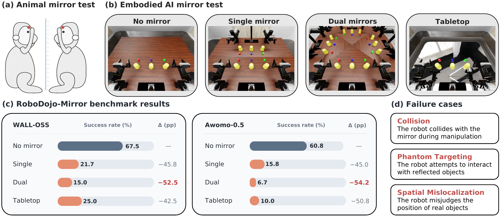
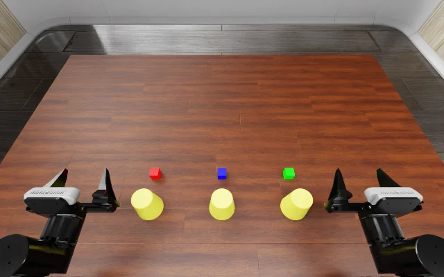
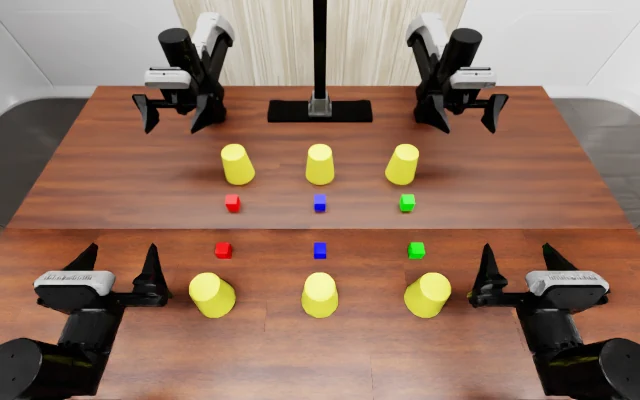
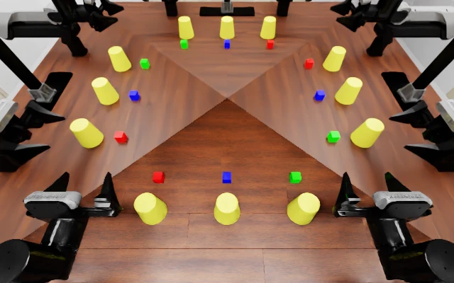
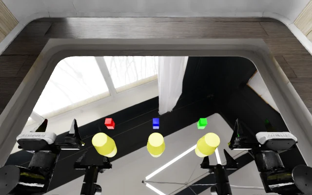

<p align="center">
  
</p>

<h1 align="center">Embodied AI Fails the Mirror Test<br>How a Simple Mirror Breaks Robot Policies</h1>

<p align="center">
  <a href="https://ipplab.github.io/robodojo-mirror/"></a>
  <a href="https://arxiv.org/abs/2611.33010"></a>
  <a href="#video"></a>
  <a href="#usage"></a>
  <a href="LICENSE"></a>
</p>

<p align="center">
  Xuanchen Liu<sup>*</sup>, Hejun Zhang<sup>*</sup>, Boxuan Dong, Ying Wu,<br>
  Heshuai Li, Wen Gao, Yonghong Tian, Weihao Yu<sup>†</sup>
</p>

<p align="center">
  Peking University<br>
  <sup>*</sup>Equal contribution · <sup>†</sup>Corresponding author
</p>

## Overview

RoboDojo-Mirror measures how reflections affect robot manipulation. It adds mirror conditions to RoboDojo while keeping the tasks, initial layouts, policy checkpoints, and native scoring fixed. The benchmark also includes geometry-matched nonreflective panels for comparing reflections with physical obstacles.



## News

- **2026-11-24** — Prepared the RoboDojo-Mirror scene package and the project page preview.

## Video

https://github.com/user-attachments/assets/09052d10-bfef-4ddf-8a4c-e47cd4101c8c

## Todo List

- [x] Implement the mirror scenes and nonreflective controls.
- [x] Add an [existing-policy integration example](examples/existing_policy.py) and task-selection CLI.
- [x] Prepare the [project page](https://ipplab.github.io/robodojo-mirror/) and project video.
- [ ] Expand the benchmark with more mirror-based manipulation tasks.

## Usage

The runtime uses your RoboDojo installation and its robot, object, and layout assets. Obtain policy adapters and checkpoints from their upstream releases. See the [source and asset notices](THIRD_PARTY_NOTICES.md).

### Get started

```bash
git clone https://github.com/iPPLab/robodojo-mirror.git
cd robodojo-mirror
```

1. Set up RoboDojo with Isaac Sim, Isaac Lab, and its assets using the [official installation guide](https://robodojo-benchmark.com/doc/usage/install-and-download/). Activate that environment and make sure NumPy and SciPy are available.
2. Install RoboDojo-Mirror from this checkout and check the evaluator interfaces.

   ```bash
   python -m pip install --no-deps .
   export ROBODOJO_ROOT=/path/to/RoboDojo
   robodojo-mirror check-source --robodojo-root "$ROBODOJO_ROOT"
   robodojo-mirror list-tasks --robodojo-root "$ROBODOJO_ROOT"
   ```

   For local development, use `python -m pip install --no-deps -e .`. The source check inspects method availability. The matched run below exercises the simulator and evaluator.

### Connect your evaluator

Keep your existing policy service and native evaluation loop. From the RoboDojo-Mirror checkout, make a writable copy of the RoboDojo evaluator:

```bash
export MIRROR_EVAL="$PWD/robodojo_mirror_eval.py"
cp "$ROBODOJO_ROOT/src/eval_client/main.py" "$MIRROR_EVAL"
```

In that copy, add the import and insert `configure_launcher(args_cli)` immediately before the existing `AppLauncher` call, as shown below.

```python
from robodojo_mirror import MirrorConfig, attach, configure_launcher

configure_launcher(args_cli)
app_launcher = AppLauncher(args_cli)
```

Immediately after creating the environment and before its first reset, add:

```python
import os

condition = os.environ.get("ROBODOJO_MIRROR_CONDITION", "no_mirror")
attach(env, MirrorConfig(condition=condition))
```

RGB is rendered on demand. For state-only policies, use `MirrorConfig(condition=condition, capture_rgb=False)`. The adapter disables automatic rollout video recording.

### Policy adapters

Use the upstream RoboDojo adapter for the policy you want to evaluate. Keep each adapter's own action space, dependencies, and server setup. The mirror hooks above attach to the evaluator environment. The example below uses WALL-OSS.

| Paper policy | Upstream adapter | Checkpoint or service |
| --- | --- | --- |
| WALL-OSS | [WallX](https://github.com/XPolicyLab/XPolicyLab/tree/main/policy/WallX) | [WALL-OSS 1.0 Lite RoboDojo](https://huggingface.co/x-square-robot/wall-oss-1.0-lite-robodojo) |
| VPP2 | [VPP2](https://github.com/XPolicyLab/XPolicyLab/tree/main/policy/VPP2) | Released `joint2b_s100000` bundle |
| Awomo-0.5 | [Awomo05](https://github.com/XPolicyLab/XPolicyLab/tree/main/policy/Awomo05) | [Original RoboDojo checkpoint](https://huggingface.co/Auwomo/Awomo-0.5-Robodojo) used in the paper |
| Rex-M1 Preview | [Rex_M1_preview](https://github.com/XPolicyLab/XPolicyLab/tree/main/policy/Rex_M1_preview) | Released RoboDojo checkpoint described in the adapter guide |
| GPT-6-Astra | [GPT_6_Astra_Direct_EEF](https://github.com/XPolicyLab/XPolicyLab/tree/main/policy/GPT_6_Astra_Direct_EEF) | Upstream API-backed adapter with provider access |

For each policy, use its own launch instructions and keep the checkpoint or served model, task, and layout fixed across mirror conditions. The paper scores appear in [Benchmark Results](#benchmark-results).

### Run a matched pair

Follow the [WallX adapter instructions](https://github.com/XPolicyLab/XPolicyLab/blob/main/policy/WallX/README.md) to start the WALL-OSS policy service with the [RoboDojo checkpoint](https://huggingface.co/x-square-robot/wall-oss-1.0-lite-robodojo). Use the service's port below. Set up the policy adapter on `PYTHONPATH` as required by its instructions, then add the RoboDojo checkout using its absolute path.

The smoke test requests one scored `press_by_number` episode per condition with `EVAL_NUM=1`. Here, `--seed 0` selects the RoboDojo layout library. Set the policy seed separately in the service and reset it to the same value before each rollout for a seed-matched comparison. Use the same checkpoint for both runs.

```bash
export PYTHONPATH="${PYTHONPATH:+$PYTHONPATH:}$ROBODOJO_ROOT"
export ROBODOJO_POLICY_PORT=19006

RUN_DIR="$(mktemp -d)" && cd "$RUN_DIR" || exit 1
for condition in no_mirror dual_mirror; do
  mkdir "$condition" || exit 1
  (
    cd "$condition" || exit 1
    EVAL_NUM=1 ROBODOJO_RUN_ID="mirror_smoke_${condition}" \
      ROBODOJO_MIRROR_CONDITION="$condition" \
      python "$MIRROR_EVAL" \
        --task_name press_by_number --num_envs 1 --env_cfg_type arx_x5 \
        --device_id 0 --policy_name WallX --host 127.0.0.1 \
        --port "$ROBODOJO_POLICY_PORT" --additional_info "$condition" \
        --seed 0 --headless --enable_cameras
  ) || exit 1
done

find . -name _result.json -print
```

Check each condition's native `_result.json` for exactly one scored episode and `layout_id: 0`. A scored task failure still completes the smoke test. The matched run was verified in a prepared local RoboDojo environment. Compatibility with a fresh public checkout remains unverified.

### Tasks and Scenes

| No mirror | Single mirror | Dual mirrors | Mirrored tabletop |
| --- | --- | --- | --- |
|  |  |  |  |

| Condition | Scene change |
| --- | --- |
| `no_mirror` | Original RoboDojo scene |
| `single_mirror` | One vertical mirror with a 5 cm requested clearance and a tabletop-edge clamp |
| `dual_mirror` | Two perpendicular vertical mirrors with 5 cm offsets from their respective support planes |
| `mirror_tabletop` | Reflective material on the original tabletop surface |

`single_panel` and `dual_panel` are optional nonreflective controls for diagnostic experiments. Benchmark scores use the four conditions above.

The paper task set is Cover Blocks, Fold Clothes, General Pickup, Press by Number, Insert Tubes, Swap T, Stack Blocks, and Stack Bowls. List the eligible tasks in your checkout or supply your own selection:

```bash
robodojo-mirror list-tasks --robodojo-root "$ROBODOJO_ROOT" --task-set all --show-excluded
robodojo-mirror list-tasks --robodojo-root "$ROBODOJO_ROOT" --tasks cover_blocks insert_key
```

Pass the selected tasks to your evaluator. General selection excludes the conveyor tasks, `make_kong`, `play_tic_tac_toe`, `organize_table`, and random variants. The mirrored tabletop is unavailable for `match_and_pick_from_conveyor`. Dual mirrors and dual panels are unavailable for `put_bottles_into_dustbin`.

## Benchmark Results

Success rate (%) across the paper task set. Mean drop is the no-mirror success rate minus the average across the three mirror conditions, in percentage points.

| Policy | No mirror | Single mirror | Dual mirrors | Mirrored tabletop | Mean drop (pp) |
| --- | ---: | ---: | ---: | ---: | ---: |
| WALL-OSS | 67.5 | 21.7 | 15.0 | 25.0 | 46.9 |
| VPP2 | 72.5 | 33.3 | 35.0 | 27.5 | 40.6 |
| Awomo-0.5 | 60.8 | 15.8 | 6.7 | 10.0 | 50.0 |
| Rex-M1 Preview | 66.7 | 15.8 | 10.0 | 4.2 | 56.7 |
| GPT-6-Astra | 65.0 | 62.5 | 52.5 | 47.5 | 10.8 |

## Citation

```bibtex
@article{liu-zhang-mirror-test,
  title  = {{Embodied AI Fails the Mirror Test: How a Simple Mirror Breaks Robot Policies}},
  author = {Liu, Xuanchen and Zhang, Hejun and Dong, Boxuan and Wu, Ying
            and Li, Heshuai and Gao, Wen and Tian, Yonghong and Yu, Weihao},
  journal = {arXiv preprint arXiv:2611.33010},
  year = {2026}
}
```
